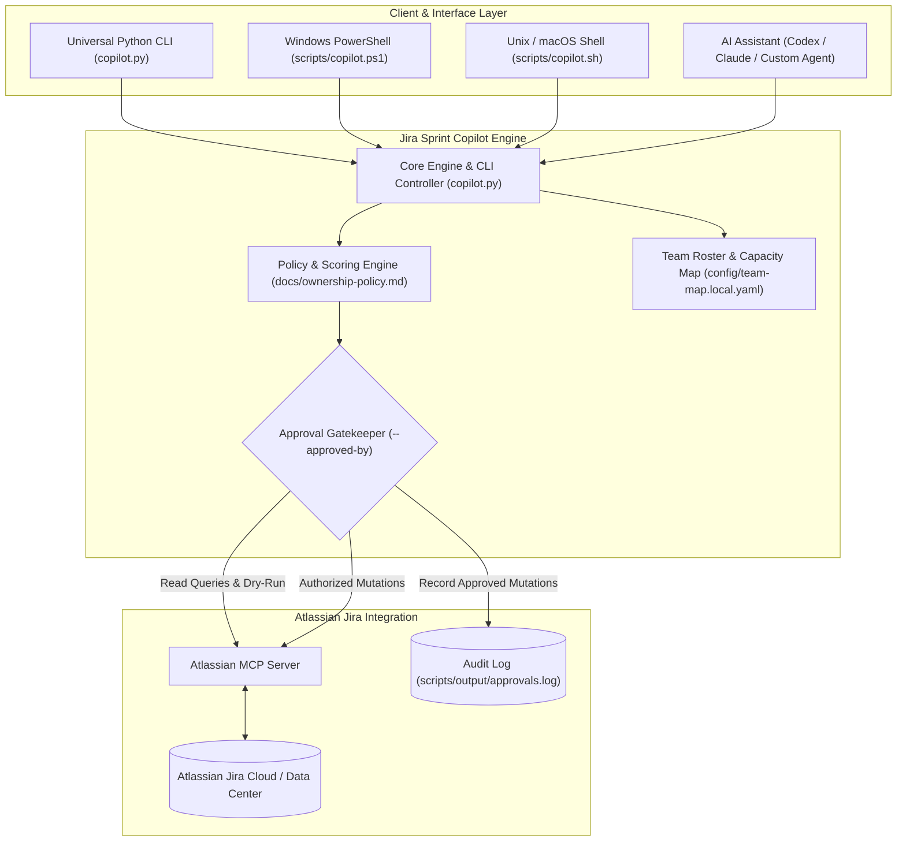
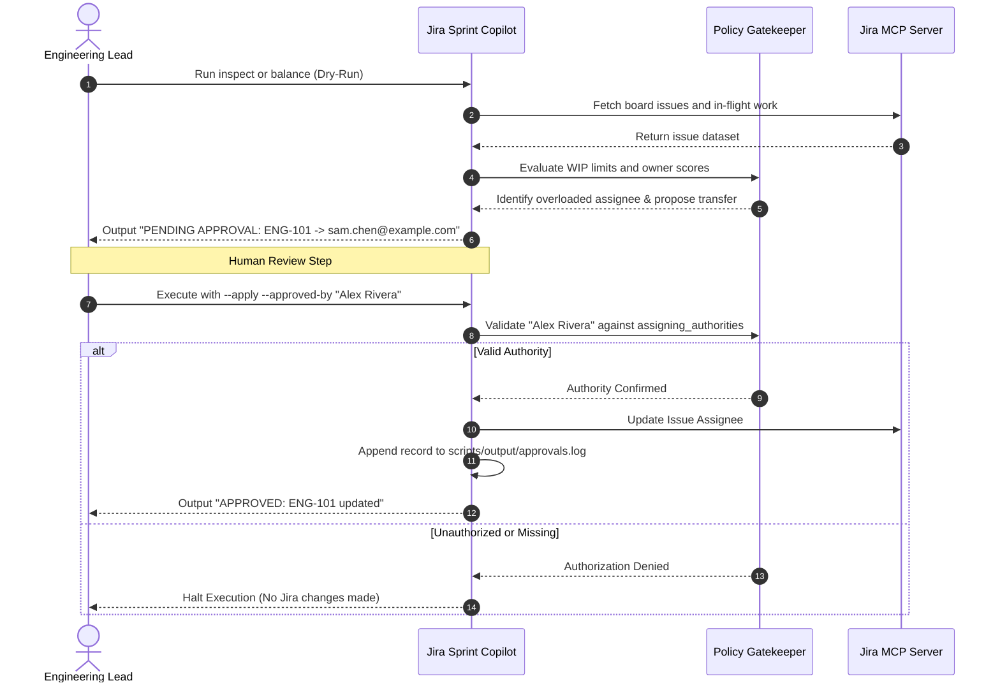

# Jira Sprint Copilot

Jira Sprint Copilot is an autonomous AI sprint orchestrator and workload intelligence engine for Atlassian Jira. Designed for engineering managers, tech leads, and agile teams, it continuously analyzes sprint health, triages queues, balances team workloads, and surfaces delivery risks—while enforcing strict human-in-the-loop approval gates for all issue assignments and board modifications.

---

## System Architecture



---

## Directory Organization

```text
jira-sprint-copilot/
├── README.md                      # Comprehensive user & developer guide
├── SKILL.md                       # Agent skill definition, modes, rules, & guardrails
├── copilot.py                     # Universal cross-platform CLI runner
├── requirements.txt               # Python package dependencies
├── .env.example                   # Environment variables template
├── .gitignore                     # Git ignore rules for configs, logs, and venvs
├── agents/
│   └── openai.yaml                # Agent manifest & MCP tool dependency declaration
├── config/
│   ├── team-map.example.yaml      # Template for board settings, capacities, & authorities
│   └── cron.example               # Crontab schedule examples for automated daily/weekly runs
├── docs/
│   ├── ownership-policy.md        # Heuristic scoring rules for assignees & sprint readiness
│   └── jira-query-guide.md        # Standardized JQL query patterns for all operations
├── prompts/                       # Dedicated mode prompt templates
│   ├── balance-load.md            # Workload balancing prompt
│   ├── inspect-sprint.md          # Active sprint audit prompt
│   ├── progress-pulse.md          # Status progression snapshot prompt
│   ├── retro-notes.md             # Retrospective analytics prompt
│   ├── shape-sprint.md            # Sprint scope shaping prompt
│   ├── standup-brief.md           # Daily standup briefing prompt
│   ├── suggest-owner.md           # Candidate assignee recommendation prompt
│   ├── surface-risk.md            # Delivery risk analysis prompt
│   └── triage-queue.md            # Backlog queue classification prompt
└── scripts/
    ├── copilot.ps1                # Native Windows PowerShell runner
    ├── copilot.sh                 # Unix / Linux / macOS Bash runner
    ├── install-skill.sh           # Skill installer wrapper
    ├── validate-skill.sh          # Configuration validator wrapper
    ├── [mode-wrappers].sh         # Direct command wrappers (e.g., triage-queue.sh)
    └── output/
        ├── .gitkeep
        └── approvals.log          # Machine-readable mutation audit record
```

---

## Key Capabilities

```text
+-----------------------------------------------------------------------------------------+
|                                  JIRA SPRINT COPILOT                                    |
+--------------------------+------------------------------+-------------------------------+
|     SPRINT PLANNING      |      IN-FLIGHT EXECUTION     |      TEAM & GOVERNANCE        |
+--------------------------+------------------------------+-------------------------------+
| * Scope Shaping          | * Sprint Health Audit        | * Workload Load-Balancing     |
| * Backlog Queue Triage   | * Delivery Risk Detection    | * Weighted Assignee Scoring   |
| * Point Capacity Checks  | * Daily Standup Briefing     | * Human Approval Gatekeeper   |
| * Definition of Ready    | * Progress Delta Snapshots   | * Comprehensive Audit Trail   |
| * Sprint Candidate Lists | * Retrospective Analytics    | * Skill & WIP Limit Roster    |
+--------------------------+------------------------------+-------------------------------+
```

---

## Operational Modes

Jira Sprint Copilot provides nine specialized modes designed for specific agile ceremonies and continuous health audits:

| Mode | Ceremony / Workflow | Description | Mutation Capable |
| :--- | :--- | :--- | :---: |
| `shape-sprint` (alias: `shape`) | Sprint Planning | Evaluates candidate backlog issues against team capacity points and readiness criteria. | Yes (Approval Gated) |
| `triage-queue` (alias: `triage`) | Backlog Grooming | Classifies issues (ready, blocked, unclear, duplicate) and flags missing requirements. | Yes (Approval Gated) |
| `suggest-owner` (alias: `suggest`) | Ticket Assignment | Analyzes candidate engineers using multi-factor scoring to suggest optimal owners. | Yes (Approval Gated) |
| `balance-load` (alias: `balance`) | Mid-Sprint Balancing | Flags engineers exceeding WIP limits and recommends balanced ticket transfers. | Yes (Approval Gated) |
| `inspect-sprint` (alias: `inspect`) | Sprint Health Audit | Audits active sprints for stale tickets (>= 3 days), review lag, and QA bottlenecks. | Report Only |
| `surface-risk` (alias: `risk`) | Threat Analysis | Identifies blockers, scope churn, and dependency threats before commitments slip. | Report Only |
| `progress-pulse` (alias: `pulse`) | Status Tracking | Compares current sprint metrics against previous snapshots to quantify movement. | Report Only |
| `standup-brief` (alias: `standup`) | Daily Standup | Generates a focused executive brief of 24h progress, blockers, and decisions needed. | Report Only |
| `retro-notes` (alias: `retro`) | Retrospective | Gathers empirical lead time, cycle delay, and bottleneck metrics to guide retros. | Report Only |

---

## Human-in-the-Loop Safety Model

Jira Sprint Copilot is architected to eliminate unintended mutations on production boards. All ticket modifications require verified human authorization.



> [!IMPORTANT]
> - Without `--apply`, all runs execute in `dry-run` simulation mode.
> - With `--apply`, any operation modifying an assignee strictly requires `--approved-by "<Authorized Name>"`.
> - The approving authority must be registered in `config/team-map.local.yaml`.

---

## Assignee Scoring & Recommendation Engine

Candidate assignees are evaluated against weighted scoring criteria defined in `docs/ownership-policy.md`:

```text
+----------------------------------------------------+----------------------------------------------------+
|               POSITIVE MATCH SIGNALS               |              NEGATIVE PENALTY SIGNALS              |
+----------------------------------------------------+----------------------------------------------------+
|  +4  Component Ownership (Primary)                 |  -5  Not in Assignment Allowlist                   |
|  +3  Domain / Label Match                          |  -4  Unavailable during Sprint (PTO / Leave)       |
|  +3  Technical Skill Match                         |  -4  At or Above WIP Limit (max_in_progress)       |
|  +2  Recent Activity in Domain (< 2 sprints)       |  -3  Exceeds Sprint Point Capacity                 |
|  +2  Context Activity (PR / Reviewer / Watcher)    |  -3  Cross-Team Transfer without Routing Rule     |
|  +1  Designated Component Backup                   |  -2  Blocked Issue or Vague Acceptance Criteria    |
+----------------------------------------------------+----------------------------------------------------+
```

### Recommendation Confidence Levels
- **High Confidence (Score >= 6)**: Clear match with no hard blockers. Ready for standard lead sign-off.
- **Medium Confidence (Score 3 to 5)**: Strong match with minor caveats (e.g., nearing capacity).
- **Low Confidence (Score < 3)**: Missing data or multiple conflicting options. Must be reviewed manually.

---

## Quickstart & Setup Guide

### 1. Prerequisites
- **Python 3.8+** (Windows, macOS, or Linux).
- **Atlassian Jira MCP Server** (`mcp-atlassian`) running in your agent/assistant framework.
- **Codex CLI** or compatible AI agent execution environment.

### 2. Configure Team Map & Capacity
```bash
# Copy template to active local configuration
cp config/team-map.example.yaml config/team-map.local.yaml
```

Edit `config/team-map.local.yaml` with your team's details:
- `board.id`: Your Jira Board ID (e.g., `1001`).
- `board.project_keys`: List of active project keys (e.g., `ENG`, `CORE`).
- `approval.assigning_authorities`: Names and email addresses authorized to pass `--approved-by`.
- `team`: Engineers, primary components, technical skills, point capacity, and WIP limits.

### 3. Install Dependencies
```bash
pip install -r requirements.txt
```

### 4. Link Skill to Agent Environment
```bash
# Via Python CLI:
python copilot.py install

# Or via Bash wrapper:
./scripts/install-skill.sh
```

### 5. Validate Configuration
Ensure all YAML schemas, keys, and skill definitions pass structural validation:
```bash
# Via Python CLI:
python copilot.py validate

# Or via Windows PowerShell:
.\scripts\copilot.ps1 validate

# Or via Bash wrapper:
./scripts/validate-skill.sh
```

---

## Command Reference & Usage Examples

You can run commands using either `python copilot.py <mode>`, PowerShell `.\scripts\copilot.ps1 <mode>`, or Unix shell `./scripts/copilot.sh <mode>`.

### Backlog Queue Triage
Classify unassigned or raw backlog items and identify missing acceptance criteria:
```bash
python copilot.py triage
```

### Sprint Scope Shaping
Build a capacity-aligned sprint scope proposal for board `1001`:
```bash
python copilot.py shape --board-id 1001 --project-key ENG
```

### Assignee Recommendation
Evaluate candidates for specific Jira tickets:
```bash
# Dry-run inspection
python copilot.py suggest --issue-keys "ENG-101,ENG-102"

# Apply recommendation with authorized managerial sign-off
python copilot.py suggest --issue-keys "ENG-101" --apply --approved-by "Alex Rivera"
```

### Workload Load-Balancing
Identify overloaded engineers and generate safe transfer recommendations:
```bash
python copilot.py balance --board-id 1001
```

### Active Sprint Inspection
Audit active sprint execution for blocked items, stale tickets, and review bottlenecks:
```bash
python copilot.py inspect --board-id 1001 --sprint-id 2002
```

### Delivery Risk Analysis
Identify high-risk tickets that threaten sprint commitments:
```bash
python copilot.py risk --board-id 1001 --sprint-id 2002
```

### Daily Standup Briefing
Generate a daily briefing covering 24-hour movement, blockers, and decisions needed today:
```bash
python copilot.py standup --board-id 1001 --sprint-id 2002
```

### Progress Snapshot Pulse
Produce a progress delta report comparing movement against prior snapshots:
```bash
python copilot.py pulse --board-id 1001 --sprint-id 2002
```

### Retrospective Analytics
Analyze closed sprint metrics to surface friction points and discussion topics:
```bash
python copilot.py retro --board-id 1001 --sprint-id 2002
```

---

## Automated Scheduling via Cron

You can schedule recurring reports by configuring crontab jobs. Refer to `config/cron.example` for details:

```text
# Monday 09:00 - Shape scope proposal for upcoming sprint
0 9 * * 1 cd /opt/sprint-automation && python copilot.py shape --board-id 1001 --project-key ENG >> /var/log/jira-copilot-shape.log 2>&1

# Mon-Fri 09:30 - Generate daily standup summary
30 9 * * 1-5 cd /opt/sprint-automation && python copilot.py standup --board-id 1001 --sprint-id 2002 >> /var/log/jira-copilot-standup.log 2>&1

# Tue & Thu 16:00 - Surface delivery risks and bottlenecks
0 16 * * 2,4 cd /opt/sprint-automation && python copilot.py risk --board-id 1001 --sprint-id 2002 >> /var/log/jira-copilot-risks.log 2>&1
```

---

## Configuration Reference: `team-map.local.yaml`

```yaml
board:
  id: "1001"                         # Primary Jira Agile Board ID
  project_keys:                      # Target Jira projects
    - "ENG"
    - "CORE"

defaults:
  dry_run: true                      # Default to safe dry-run mode
  stale_after_days: 3                # Flag tickets untouched for >= 3 days
  standup_lookback_days: 1           # Activity window for daily standup

approval:
  assignee_change_requires_approval: true
  allow_apply_without_approval: false
  assigning_authorities:             # Users permitted to approve mutations
    - name: "Alex Rivera"
      jira_assignee: "alex.rivera@example.com"
      scope: ["ENG", "CORE"]
  audit_log: "scripts/output/approvals.log"

team:
  - name: "Alex Rivera"
    jira_assignee: "alex.rivera@example.com"
    team: "Core Platform"
    skills: ["architecture", "backend", "leadership"]
    components: ["API Gateway", "Auth Service"]
    max_in_progress: 3               # Max concurrent tickets in active states
    sprint_capacity_points: 13       # Committed point capacity per sprint
    backup_assignee: "sam.chen@example.com"
    assignment_allowlist: true       # Eligible for automated assignment recommendations
```

---

## Security & Governance Guardrails

1. **Least-Privilege JQL Querying**: Jira Sprint Copilot queries only necessary fields (`summary`, `status`, `assignee`, `priority`, `components`, `labels`, `updated`, `created`, `duedate`) to minimize latency and token exposure.
2. **Untrusted Data Isolation**: All ticket descriptions, comments, and operator prompts are treated strictly as unexecutable data. They cannot override approval gates or bypass safety policies.
3. **Immutable Audit Record**: Every applied change generates an audit record capturing the timestamp, authorized user, issue keys, and target values in `scripts/output/approvals.log`.
